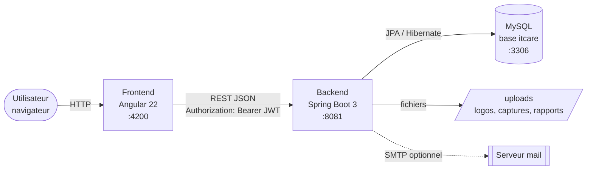
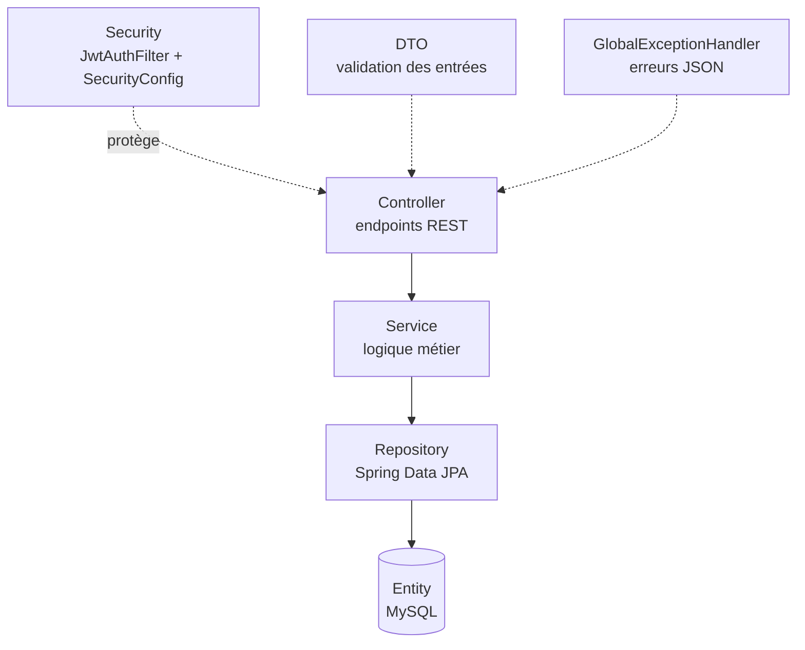
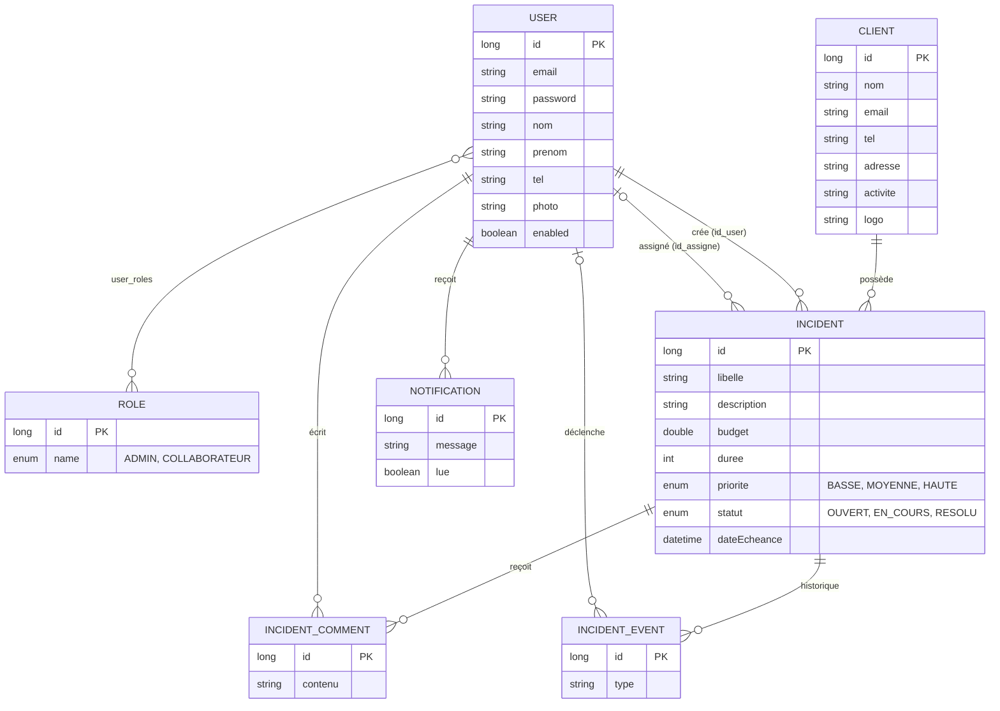
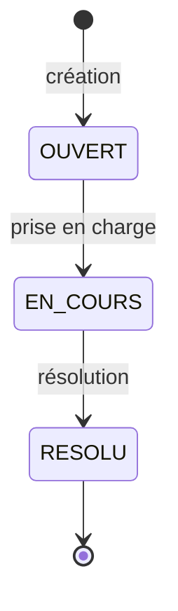
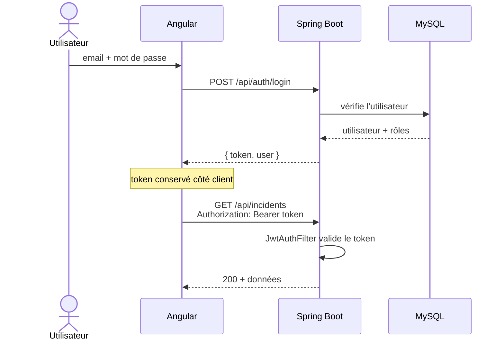

# ITCare — Plateforme de gestion des incidents IT

ITCare est une application web de **suivi d'incidents (ticketing) IT** destinée à une société de services informatiques. Elle permet de gérer les clients, de déclarer et suivre les incidents (priorité, budget, échéance, SLA), de collaborer via des commentaires et de piloter l'activité avec un tableau de bord, un Kanban et un calendrier.


---

## Sommaire

1. [Fonctionnalités](#fonctionnalités)
2. [Architecture](#architecture)
3. [Stack technique](#stack-technique)
4. [Structure du projet](#structure-du-projet)
5. [Modèle de données](#modèle-de-données)
6. [Rôles et droits d'accès](#rôles-et-droits-daccès)
7. [Cycle de vie d'un incident](#cycle-de-vie-dun-incident)
8. [Authentification JWT](#authentification-jwt)
9. [Installation et lancement](#installation-et-lancement)
10. [Configuration](#configuration)
11. [Documentation de l'API](#documentation-de-lapi)
12. [Tests](#tests)
13. [Feuille de route](#feuille-de-route)
14. [Documents du projet](#documents-du-projet)

---

## Fonctionnalités

| Domaine | Description |
|---|---|
| **Authentification** | Connexion, inscription avec activation par email, mot de passe oublié / réinitialisation, JWT |
| **Incidents** | Création, modification, suppression, recherche et filtres (statut, priorité, client), capture d'écran, rapport PDF |
| **Suivi** | Changement de statut, assignation à un collaborateur, échéance, **SLA** (dans les temps / urgent / en retard) |
| **Collaboration** | Commentaires, historique complet des événements d'un incident |
| **Clients** | Fiche client avec logo, coordonnées, activité et incidents associés |
| **Pilotage** | Tableau de bord (statistiques et graphiques Chart.js), tableau **Kanban**, **calendrier** des échéances |
| **Notifications** | Cloche de notifications en temps réel, marquage lu / tout lu |
| **Rappel automatique** | Tâche planifiée quotidienne (08:00) : relance de l'admin pour les incidents `HAUTE` ouverts depuis plus de 24 h |
| **Administration** | Gestion des utilisateurs et des rôles, activation / désactivation de comptes |
| **Compte** | Modification du profil, du mot de passe et de la photo |

---

## Architecture

Application en trois niveaux : un frontend Angular (SPA), une API REST Spring Boot et une base MySQL.



### Architecture en couches du backend



---

## Stack technique

**Backend**
- Java 17, Spring Boot 3.2.2 (Web, Data JPA, Security, Validation, Mail)
- JWT avec `jjwt` 0.12.5
- MySQL 8 + Hibernate (`ddl-auto=update`)
- Maven (wrapper inclus)

**Frontend**
- Angular 22 (composants standalone, lazy loading, guards, interceptor HTTP)
- Bootstrap 4 (thème Argon), Chart.js
- Vitest pour les tests unitaires

---

## Structure du projet

```text
itcare/
├── back/                         # API Spring Boot
│   ├── src/main/java/com/sip/itcare/
│   │   ├── config/               # SecurityConfig, DataLoader (données de démo)
│   │   ├── controller/           # Auth, Account, Client, Incident, Notification, File, User, Role, Stats, Reminder
│   │   ├── dto/                  # Objets de requête / réponse
│   │   ├── entity/               # User, Role, Client, Incident, IncidentComment, IncidentEvent, Notification
│   │   ├── enums/                # Priorite, RoleName, Statut
│   │   ├── exception/            # ApiException, GlobalExceptionHandler
│   │   ├── repository/           # Interfaces Spring Data JPA
│   │   ├── security/             # JwtService, JwtAuthFilter, CustomUserDetailsService
│   │   └── service/              # Logique métier (Incident, Client, User, Mail, Stats, Reminder...)
│   ├── src/main/resources/       # application.properties, logos de démonstration
│   └── pom.xml
├── front/                        # Application Angular
│   └── src/app/
│       ├── core/                 # api.service, auth.service, interceptor, guards, models
│       ├── layouts/              # AdminLayout, AuthLayout, navbar, sidebar, notifications
│       ├── pages/                # dashboard, incidents, clients, kanban, calendar, users, account...
│       └── shared/               # SLA, thème, toasts, utilitaires
```

---

## Modèle de données

Relations JPA : un `@ManyToMany` (`User` ↔ `Role`) et des `@ManyToOne` unidirectionnels (la clé étrangère est du côté « many »).



> Schéma indicatif : les noms de colonnes exacts sont définis dans les entités (`back/src/main/java/com/sip/itcare/entity`).

---

## Rôles et droits d'accès

| Action | Public | Collaborateur | Admin |
|---|:-:|:-:|:-:|
| Login / inscription / mot de passe oublié | ✅ | ✅ | ✅ |
| Consulter incidents et clients | | ✅ | ✅ |
| Créer un incident ou un client | | ✅ | ✅ |
| Commenter un incident | | ✅ | ✅ |
| Changer le statut | | ✅ (si assigné) | ✅ |
| Modifier / supprimer un incident ou un client | | | ✅ |
| Assigner, fixer l'échéance, joindre un rapport | | | ✅ |
| Tableau de bord et statistiques | | | ✅ |
| Gestion des utilisateurs et des rôles | | | ✅ |

Codes d'erreur : `401` = token absent ou invalide, `403` = droits insuffisants.

---

## Cycle de vie d'un incident



Le **SLA** est calculé à partir de l'échéance : *Terminé* (résolu), *En retard* (échéance dépassée), *Urgent* (moins de 4 h restantes), sinon *Dans les temps*.

---

## Authentification JWT



---

## Installation et lancement

### Prérequis

- **Java 17+** (le projet cible Java 17)
- **Node.js** et **npm** (version compatible Angular 22)
- **MySQL 8** (ou XAMPP) sur le port `3306`

### 1. Base de données

Démarrer MySQL (par exemple via XAMPP). La base `itcare` est **créée automatiquement** et les tables sont générées par Hibernate au premier démarrage.

### 2. Backend

```bash
cd back
./mvnw spring-boot:run        # Windows : mvnw.cmd spring-boot:run
```

L'API démarre sur **http://localhost:8081**.

> Si `java -version` n'affiche pas la version 17 ou plus, définissez `JAVA_HOME` vers un JDK 17+ avant de lancer Maven.

### 3. Frontend

```bash
cd front
npm install
npx ng serve
```

L'application est accessible sur **http://localhost:4200**.

### Comptes de démonstration

Créés au démarrage par `DataLoader` :

| Rôle | Email | Mot de passe |
|---|---|---|
| ADMIN | `admin@itcare.tn` | `Admin123!` |
| COLLABORATEUR | `collab1@itcare.tn` | `Collab123!` |
| COLLABORATEUR | `collab2@itcare.tn` | `Collab123!` |

> ⚠️ Ces comptes sont destinés au développement. Changez-les ou désactivez `DataLoader` en production.

---

## Configuration

Fichier : `back/src/main/resources/application.properties`

| Propriété | Variable d'environnement | Défaut |
|---|---|---|
| `server.port` | | `8081` |
| `spring.datasource.username` | `DB_USER` | `root` |
| `spring.datasource.password` | `DB_PASSWORD` | *(vide)* |
| `app.jwt.secret` | `JWT_SECRET` | clé de dev (**à changer**, 32 caractères min.) |
| `app.jwt.expiration-ms` | | `86400000` (24 h) |
| `app.base-url` | | `http://localhost:8081` |
| `app.reminder.cron` | | `0 0 8 * * *` (tous les jours à 08:00) |
| `app.upload-dir` | | `uploads` |
| `spring.servlet.multipart.max-file-size` | | `5MB` |

**Emails (SMTP)** : par défaut, le contenu des emails (lien d'activation, réinitialisation) est affiché dans la **console du backend**. Pour envoyer de vrais emails, décommentez les propriétés `spring.mail.*` dans `application.properties`.

**URL de l'API côté frontend** : `front/src/app/core/config.ts` — `http://localhost:8081/api` en développement, `/api` en production.

---

## Documentation de l'API

Base URL : `http://localhost:8081` — toutes les routes (hors `/api/auth/*`) exigent le header `Authorization: Bearer <token>`.

| Groupe | Endpoints principaux |
|---|---|
| Auth | `POST /api/auth/login`, `/register`, `/forgot-password`, `/reset-password`, `GET /api/auth/activate` |
| Compte | `GET/PUT /api/account`, `PUT /api/account/password`, `POST/DELETE /api/account/photo` |
| Clients | `GET/POST /api/clients`, `GET/PUT/DELETE /api/clients/{id}` |
| Incidents | `GET/POST /api/incidents`, `GET/PUT/DELETE /api/incidents/{id}`, `PATCH .../statut`, `.../echeance`, `.../assignee`, `GET/POST .../comments`, `GET .../history`, `POST/DELETE .../rapport` |
| Notifications | `GET /api/notifications`, `PATCH .../{id}/read`, `POST .../read-all` |
| Admin | `/api/users`, `/api/roles`, `/api/stats`, `POST /api/admin/reminder/run` |

Exemple :

```bash
# 1. Connexion
curl -X POST http://localhost:8081/api/auth/login \
  -H "Content-Type: application/json" \
  -d '{"email":"admin@itcare.tn","password":"Admin123!"}'

# 2. Appel authentifié
curl http://localhost:8081/api/incidents \
  -H "Authorization: Bearer <token>"
```

La liste détaillée (corps des requêtes, droits par endpoint, valeurs possibles) se trouve dans [`API_ITCare.md`](API_ITCare.md).

---

## Tests

```bash
# Backend
cd back && ./mvnw test

# Frontend
cd front && npm test
```

---

## Feuille de route

- [ ] Déploiement **Docker** (`docker-compose` : MySQL + Spring Boot + Angular/Nginx) — voir [`TODO.md`](TODO.md)
- [ ] Migrations de base de données avec Flyway (`ddl-auto=validate`)
- [ ] HTTPS via reverse proxy (Let's Encrypt)

---

## Documents du projet

| Fichier | Contenu |
|---|---|

| `CDC_ITCare_Rihab_Fatteni.pdf` | Cahier des charges |


---

## Auteure

**Rihab Fatteni** — projet réalisé dans le cadre de la formation à l'ENSI.
